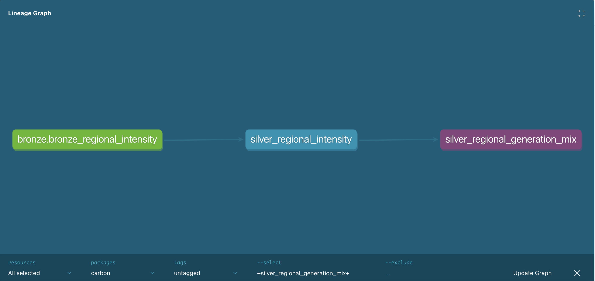

# UK Grid Carbon Intensity Pipeline

An end-to-end data pipeline that ingests half-hourly carbon intensity data for Great Britain's electricity grid from the National Grid ESO API, and models it using a medallion (bronze / silver / gold) architecture.

## Key finding

In September 2026, electricity in Great Britain was cleanest around noon UK time (avg 74.5 g CO₂/kWh) and dirtiest around 7pm (avg 148.8 g CO₂/kWh), roughly twice as carbon-intensive. This means charging an electric car or running appliances at midday instead of the evening can halve their carbon footprint.

**Why:** the generation mix explains it. Solar peaks at 22.4% of GB generation around 11:00–12:00 UTC, the same hours as the lowest carbon intensity, while gas falls to 12.3%. By 18:00 UTC (7pm UK) solar has dropped to near zero just as demand peaks, and gas rises to 30.4% to fill the gap, the same hour as the highest carbon intensity.

| UTC hour | Carbon intensity (g/kWh) | Solar % | Gas % |
|---|---|---|---|
| 05:00 | 125.1 | 0.3 | 23.5 |
| 11:00 | **74.5** (lowest) | **22.4** (highest) | **12.3** (lowest) |
| 18:00 | **148.8** (highest) | 0.4 | **30.4** (highest) |

## Architecture

```
National Grid Carbon Intensity API
        │  ingestion/backfill.py      (Python: extract)
        ▼
data/bronze/*.json                    raw API responses, one file per day
        │  ingestion/load_bronze.py   (DuckDB SQL: load)
        ▼
warehouse.duckdb
├── bronze_national_intensity           raw, timestamps as text
├── bronze_regional_intensity           raw, includes boundary duplicates
        │  dbt models + tests
        ▼
├── silver_national_intensity           1,440 rows   (one per half-hour)
├── silver_regional_intensity          25,920 rows   (one per region per half-hour)
└── silver_regional_generation_mix    233,280 rows   (one per fuel per region per half-hour)
        │
        ▼
gold → dashboard (coming next)
```

### dbt lineage



## Silver layer (dbt)

| Model | Grain | Cleaning |
|---|---|---|
| `silver_national_intensity` | one half-hour | text → timestamps, columns renamed, filtered to UTC September |
| `silver_regional_intensity` | one region per half-hour | as above, plus boundary duplicates removed with `ROW_NUMBER()` and an `is_aggregate` flag for England/Scotland/Wales/GB |
| `silver_regional_generation_mix` | one fuel per region per half-hour | `generation_mix` list unpacked into rows with `unnest`, built on the regional model with `ref()` |

13 dbt data tests check the grain of every table (`unique`, `not_null`) and the allowed intensity labels (`accepted_values`).

## Tech stack

Python (requests) · DuckDB · SQL · dbt · Git/GitHub
Planned: GitHub Actions (CI/CD) · Streamlit

## Data quality issues found

The regional table had 26,460 rows instead of the expected 25,920. Using a `GROUP BY ... HAVING` query, I found that the 23:30–00:00 period appeared in two files: once as the last period of one day, and again as the first period of the next. I kept the bronze layer unchanged so it remains a faithful copy of what the API returned and can be replayed if the cleaning logic changes.

**Resolved in silver:** I first wrote a dbt uniqueness test on region + timestamp, which failed with exactly 522 duplicates (29 boundary periods × 18 regions). I then deduplicated with `ROW_NUMBER() OVER (PARTITION BY region_id, from_ts)`, and the test passed.

Also found and handled in silver:
- Timestamps arrive as text, not timestamps, so they are cast with `strptime`
- Regional data mixes 14 real regions with 4 aggregate rows (England, Scotland, Wales, GB), which would cause double counting, so they are flagged with `is_aggregate`
- The national endpoint returns UK-local days (BST) while regional requests used UTC days, so the two tables covered different windows. I backfilled one extra day in bronze and filtered both silver tables to exactly UTC September
- Regional data includes forecasts only (no actual values)

## How to run

```bash
pip install -r requirements.txt
python ingestion/backfill.py      # fetch 1 Sep – 1 Oct 2026 into data/bronze/
python ingestion/load_bronze.py   # build bronze tables in data/warehouse.duckdb
cd dbt
dbt run --profiles-dir .          # build silver models
dbt test --profiles-dir .         # run data tests
```

## Status

- [x] Phase 1: Bronze ingestion (national + regional, September 2026)
- [x] Phase 2: Silver cleaning with dbt + data tests
- [ ] Phase 3: Gold star schema + KPIs
- [ ] Phase 4: CI/CD with GitHub Actions
- [ ] Phase 5: Streamlit dashboard
